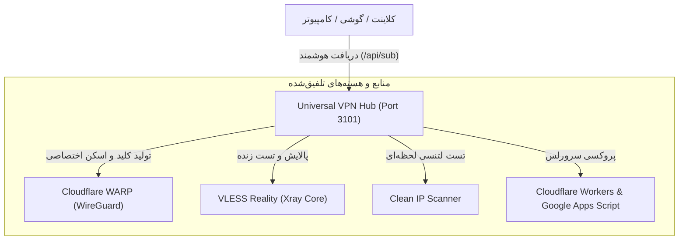

# ⚡ Universal VPN Hub & Manager

> **سامانه یکپارچه، سبک و مدرن مدیریت پروکسی و فیلترشکن با تلفیق برترین فناوری‌های ضد‌سانسور و اتصال به منابع ۱۰۰٪ رایگان**  
> *An all-in-one lightweight proxy management hub & client ecosystem combining next-gen anti-censorship tools with built-in free resources.*

---

## 🌟 درباره پروژه (About the Project)

پروژه **Universal VPN Hub & Manager** با هدف ایجاد یک راه‌حل جامع، در دسترس و بدون هزینه برای عبور از اختلالات شدید اینترنت طراحی شده است. این سیستم با ادغام نقاط قوت برترین پروژه‌های مطرح جامعه متن‌باز، امکان مدیریت، تولید و توزیع کانفیگ‌های اختصاصی و رایگان را به سادگی فراهم می‌کند.



---

## 🚀 ویژگی‌های کلیدی (Key Features)

* **⚡ تولید ۱-کلیک اکانت اختصاصی Cloudflare WARP:** ساخت کلیدهای Curve25519، ثبت در API کلودفلر و تولید کانفیگ استاندارد WireGuard با انتخاب کمترین لتنسی.
* **🎁 مخزن سرورهای لایو VLESS Reality:** تجمیع و پایش مداوم بیش از ۶,۴۰۰ سرور فعال از سراسر دنیا بدون نیاز به خرید سرور.
* **🔍 اسکنر اختصاصی Clean IP:** اسکن رنج‌های بدون فیلتر کلودفلر در اینترنت ایران به منظور دستیابی به حداکثر سرعت دانلود.
* **📱 سرور سابسکریپشن هوشمند موبایل (`/api/sub`):** ارائه لینک سابسکریپشن داینامیک و بارکد QR سازگار با تمامی کلاینت‌های اندروید و آیفون (v2rayNG, Hiddify, Happ, Streisand, V2Box).
* **🎨 داشبورد وب مدرن و واکنش‌گرا:** رابط کاربری دارک‌مود با پشتیبانی کامل از زبان فارسی و قابلیت اجرا در مرورگر موبایل و دسکتاپ.

---

## 🛠️ نحوه نصب و اجرا (Quick Start)

### پیش‌نیازها:
* Python 3.10+
* نصب نیازمندی‌ها:
```bash
pip install fastapi uvicorn cryptography qrcode pillow
```

### اجرا:
```bash
python server.py
```
سپس در مرورگر خود آدرس زیر را باز کنید:
👉 `http://localhost:3101`

---

## 🙏 تقدیر و تشکر از رفرنس‌ها (Special Thanks & Acknowledgments)

این پروژه با الهام از تلاش‌های خستگی‌ناپذیر نخبگان و توسعه‌دهندگان جامعه متن‌باز ایران و جهان شکل گرفته است. از تک‌تک پروژه‌ها و سازندگان زیر صمیمانه سپاسگزاری و قدردانی می‌کنیم:

| پروژه / مرجع | توسعه‌دهنده / سازمان | نقش و الهام در این پروژه |
| :--- | :--- | :--- |
| **[Xray-core](https://github.com/XTLS/Xray-core)** | **Team XTLS & @rprx** | خالق پروتکل‌های انقلابی VLESS و REALITY و موتور پردازش ترافیک مدرن |
| **[PurVPN](https://github.com/davudsedft/purvpn)** | **@davudsedft** | الهام‌بخش رویکرد همه‌فن‌حریف (All-in-One)، تونلینگ ترکیبی و پیاده‌سازی WARP |
| **[Hiddify-Manager](https://github.com/hiddify/Hiddify-Manager)** | **@hiddify Team** | الگوی طلایی استقرار خودکار، معماری چندکاربره و پرتال هوشمند سابسکریپشن |
| **[Happ (Proxy Utility)](https://github.com/happ-proxy)** | **@happ-proxy Team** | الهام‌بخش طراحی مینیمال، سبک و تجربه کاربری بهینه‌سازی‌شده برای موبایل و iOS |
| **[3X-UI](https://github.com/MHSanaei/3x-ui)** | **@MHSanaei (محمدحسین سنایی)** | معماری قدرتمند مدیریت ورودی‌ها (Inbounds)، فال‌بک‌ها و کنترل دسترسی‌ها |
| **[x-ui](https://github.com/alireza0/x-ui)** | **@alireza0 (علیرضا)** | پیشگام و آغازگر توسعه پنل‌های مدرن در ایران، سیستم انقضا از اولین اتصال و نوآوری‌های ربات |
| **Community Subscriptions** | **@barry-far & @MatinGhanbari** | اشتراک‌گذاری و پایش خودکار مخازن سابسکریپشن‌های رایگان برای عموم کاربران |

---

## 📄 لایسنس (License)

این پروژه تحت مجوز متن‌باز **MIT License** منتشر شده است. استفاده، مطالعه، تغییر و بازنشر آن برای همگان آزاد و رایگان است.
